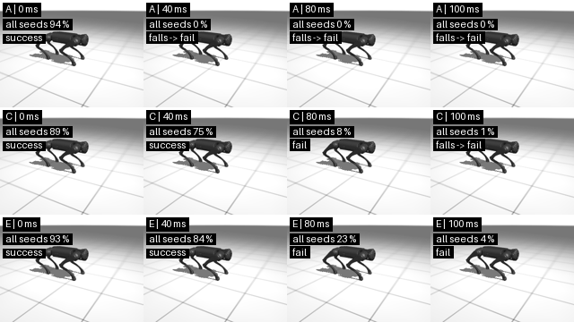
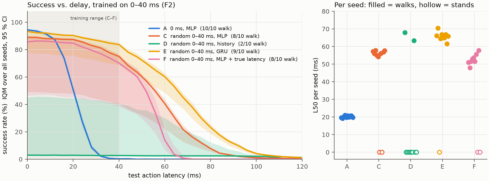

# Latency Budget: how much delay can a learned robot controller handle?

Robots act on slightly outdated information, because sensing, computing and moving take time.
This project measures how much delay a learned walking controller (simulated Unitree Go1, PPO,
MuJoCo/MJX) tolerates before it fails, and how common training methods compare. The project is closed
(2026-11-19); open questions are listed under [Further work](#further-work).

Between the moment a robot senses its body and the moment its motors respond, tens of
milliseconds pass. In simulation this delay is usually zero; on real hardware it is not. Today
engineers mostly find out how much delay a controller tolerates by trial and error.

## Research question

**How well does each method cope with delay?** Three common ways to make a learned controller
tolerate delay are trained under identical conditions and measured on the same tests:

1. **Randomizing the delay** during training (C).
2. **Adding a short history** of recent observations to what the policy sees (D).
3. **Giving the policy memory**, a recurrent network (GRU) (E).

They are compared with a controller trained without delay (A) and with an "oracle" that is told the
true delay (F). For each method: does it learn to walk, how much delay does it tolerate, what does
it cost at zero delay and in training time, and does it learn to estimate the delay internally?

The project began with six pre-registered hypotheses. They turned out to be poorly designed, and
most of their tests say little; the results below are reported without them. The hypotheses, the
analysis they produced and what was wrong with the design are on a separate page:
[`docs/hypotheses.md`](docs/hypotheses.md).

## Results



*One 20 s episode (a 0.45 m/s turning walk), the same for every panel, at 0, 40, 80 and 100 ms of
action delay (training covered 0–40 ms). Rows: A (no delay in training), C (random delay), E (random
delay + GRU). Each panel gives the method's success rate over all 10 seeds and the outcome of this
episode. A falls at 80 and 100 ms within the first 1.3 s and at 40 ms after 17.7 s; C falls at 100 ms
after 15.6 s; E stays up at every delay. A video shows falls; it cannot show tracking error: "fail"
without a fall (C and E at 80 ms, E at 100 ms) means the average speed error exceeded 0.155 m/s,
which is not visible by eye. The seed per method is fixed by rule (median L50) and the episode was
drawn at random once, so this is one example, not a summary. Full-size videos:
`uv run python scripts/make_videos.py`.*



Five methods, same PPO recipe, reward, network size and training budget, 10 seeds each, tested on
action delays from 0 to 120 ms. Success = no fall in 20 s and velocity tracked within a fixed
tolerance. **L50** = the delay at which success drops to 50 %. Numbers are interquartile means over
all seeds with 95 % bootstrap CIs; no best-seed numbers.

| Method (trained on random delay 0–40 ms, except A) | Seeds that learn to walk | L50 (ms) | Success at 0 ms |
|---|---|---|---|
| A: no delay in training, MLP | 10/10 | 20 [20, 21] | 94 % |
| C: random delay, MLP | 8/10 | 56 [28, 57] | 89 % |
| D: random delay, MLP + last 4 observations | **2/10** | 0 [0, 32] | 3 % |
| E: random delay, GRU (memory) | 9/10 | 66 [53, 67] | 93 % |
| F: random delay, MLP told the true delay | 8/10 | 51 [26, 54] | 86 % |

Ten seeds per method settle large effects, not small ones. The findings are therefore split by how
strongly the data support them.

**Well supported**

1. **A controller trained without delay fails at about one control step.** It acts every 20 ms; its
   success drops from 94 % to 50 % at 20 ms of delay (CI 19.7–20.6 ms) and to almost 0 by 32 ms.
2. **Training with random delay roughly triples the tolerable delay** (L50 20 → 56 ms for the plain
   MLP, 66 ms with a GRU), at a small cost at zero delay (C 89 % vs A 94 %).
3. **A short observation history learns to walk less often:** 2 of 10 seeds, vs 8/10 for the plain MLP
   (p = 0.02) and 9/10 for the GRU (p = 0.005). The other 8 learn to stand still.
4. **The GRU learns to estimate the delay.** A linear probe reads the true delay from its memory
   (R² 0.78 [0.71, 0.80]), far above the no-delay controller (0.41) and an untrained GRU (0.43).
5. **The GRU costs 1.9× the training time** of an MLP (12.7 vs 6.7 min per run).
6. **Training on too wide a delay range breaks learning.** With delay randomized over 0–80 ms (original
   study) the plain MLP walked in 0/10 seeds; on 0–40 ms in 8/10 (F2), and in a same-session check
   4/5 vs 0/5 (follow-up F1).

**Suggestive, not established**

7. **The GRU is the most delay-tolerant method:** highest point estimates (L50 66 vs 56 ms for the
   MLP; 9/10 vs 8/10 seeds walk), but the confidence intervals overlap.
8. **Telling the policy the true delay does not help:** F is no better than C, but "no benefit found"
   is not "no benefit".
9. **History may be slow rather than broken.** All policies first learn to stand, then step more and
   more until they walk. D's standing seeds were still stepping more at 200M steps, below the rate at
   which the others started walking (Mac-only diagnosis of the saved runs). Whether they would walk
   with more training, and why history is slower, was not tested. Its 2 walking seeds reach L50 ≈ 66
   ms, but two seeds say little.
10. **Fine-tuning a walking controller on random delay** reaches L50 ≈ 81 ms (exploratory, 5 seeds).

Full numbers, the sensor-delay test, the probe and the D diagnosis: [`docs/results.md`](docs/results.md).
Limits: one robot, one simulator family, one PPO recipe and budget; trained on action delay only.

## How the study was run

- **Fixed definitions.** The definition of success, the delay grid and the statistics were frozen
  before the experiments ([`docs/preregistration.md`](docs/preregistration.md)) and are unchanged.
  The pre-registered hypotheses are no longer used to report results (see
  [`docs/hypotheses.md`](docs/hypotheses.md)).
- **Controlled.** Same algorithm, reward, network size and training budget for every method; our
  PPO was checked against the reference Brax PPO (98 % of its return) before any experiment.
- **Checked twice.** The original study's test-time results replicate in native MuJoCo (the CPU simulator) on the same
  episodes.
- **Cheap and reproducible.** Three rented RTX 4090 sessions, about 35 GPU hours and $13 in total
  ([`docs/compute_log.md`](docs/compute_log.md)); every number and figure regenerates from saved
  runs with one command.

### History

| Stage | What happened |
|---|---|
| Original study (Nov 2026) | 8 conditions + ablations, 0–80 ms randomized delay. Most methods never learned to walk; closed as a negative result ([`docs/results.md`](docs/results.md)) |
| Follow-up F1 | Diagnosis: the 0–80 ms range, not the critic, caused the failure; narrower range and fine-tuning both fix it |
| F2 | Method comparison rerun on 0–40 ms, 10 seeds per method (results above) |
| Videos and D diagnosis | Rule-based videos (above); Mac-only look at why history learns slowly |
| Closed (2026-11-19) | Open questions below |

## Further work

Nothing below was run. Roughly in order of how much each would settle:

- **Why history learns slowly.** Continue training D's standing seeds (do they walk?), train D without
  delay (is history alone slow?), and train the plain MLP with D's narrower first layer (is it the
  width?). About 13 GPU runs, ≈ 3 h. Cheaper Mac checks first: replay all 10 checkpoints, and measure
  step quality (foot lift, step timing) of the standing seeds against the walkers just before take-off.
- **GRU vs plain MLP.** Estimate from the existing runs how many seeds would separate them, then run
  them.
- **A factorial design.** Methods were tested as packages (delay randomization + input + network).
  Crossing training delay (none / random) with input (latest observation / history) and network
  (MLP / GRU) would separate the factors.
- **The oracle's sensor-delay collapse.** F tolerates 51 ms of action delay but only 8 ms of sensor
  delay; probably because its sensor-delay input was always 0 in training. Unchecked.
- **Sensor delay and motor lag in training** at 0–40 ms (only tested at 0–80 ms, where most methods
  failed to learn).
- **Fine-tuning for every method**, not only the plain MLP, and other history lengths.
- **Generality.** Other PPO settings and budgets, another simulator, another robot, and hardware.
- **Smaller items.** Gait analysis; H1 recomputed from F2's baseline; reconcile the F2 cost estimate
  with the provider's bill; verify the year of Walsh et al. in
  [`docs/references.md`](docs/references.md) (the two 2026 arXiv references were checked).

## References

Prior work, the theory behind each method, and the tools used: [`docs/references.md`](docs/references.md).
The closest prior work is Li & Sun (arXiv 2610.32277, 2026), who showed delay randomization widens
the delay margin of a humanoid motion tracker; this project replicates that on a quadruped and adds
the history, memory, oracle and probing comparisons.

## Tech stack

Python, JAX, Flax, MuJoCo / MJX, MuJoCo Playground, Hydra, Weights & Biases, rliable.
Development and analysis run on a laptop (Apple Silicon); only training runs on rented GPUs.

## Running it

Requires [uv](https://docs.astral.sh/uv/) and macOS (Apple Silicon) or Linux.

```bash
uv sync                                         # install pinned dependencies
uv run pytest -q                                # 180 tests (~6 min): delays, no future leakage,
                                                # parity, PPO vs. NumPy/Brax references, evaluation
uv run python scripts/delay_feedback_demo.py    # demo video -> runs/phase1_delay_demo_*/
scripts/mjpython.sh scripts/view_env.py         # macOS: interactive viewer of the robot model

# Short training run on a laptop (~10 min): baseline condition A, small batch
uv run python scripts/train.py experiment=A ppo.num_envs=64 ppo.num_minibatches=4 \
    train.total_steps=2e6 train.run_prefix=smoke_ mjx_eval=smoke
uv run python scripts/plot_curves.py runs/smoke_A_*      # -> runs/<id>/curves.png
```

A full run (`uv run python scripts/train.py experiment=C seed=0`) trains for 200M steps with
8192 parallel simulations, then evaluates the policy on the whole delay grid; it is meant for
a GPU. Conditions are `A`, `B20`, `B40`, `B60`, `C`, `D`, `E`, `F`, `ablations/*`, `followup/*` and `f2/*`. Each run
writes `runs/<experiment>_<policy>_s<seed>_<commit>/`: config, commit hash, training curves,
checkpoints and per-episode evaluation results (`eval_mjx.parquet`).

All GPU work happens in one rented session, driven from the laptop:

```bash
bash scripts/gpu/push_code.sh       # laptop -> GPU machine (committed code only)
bash scripts/gpu/bootstrap.sh       # on the GPU machine: install, check GPU, short test run
bash scripts/gpu/launch_sweep.sh configs/sweeps/session_s.yaml   # on the GPU machine
bash scripts/gpu/sync_down.sh --watch                            # laptop: pull results during the run
```

The sweep runs a speed benchmark, the comparison with Brax PPO, an automatic pass/fail check
([`scripts/gpu/gate.py`](scripts/gpu/gate.py)), then the experiments in priority order: first
every condition needed for the hypotheses at 5 seeds, then extra seeds, then reference and
exploratory runs. If the session is cut short, or the measured speed means the budget only
covers part of it, the most important results are complete.
It survives losing the GPU machine: finished runs are listed in `runs/_ledger.jsonl` and skipped
when the sweep is relaunched on a new machine (`scripts/gpu/push_runs.sh <commit>`), so at most the
run in progress is repeated.

## Repository guide

- `docs/` — pre-registration (frozen), original hypotheses and their problems, results, references,
  environment notes, compute log.
- `src/latrl/envs/` — the simulation layer: `latency.py` (delay buffers), `actuator.py`
  (motor control and motor lag), `go1.py` (the robot environment with delays added),
  `specs.py` (observation layout and delay settings shared by all code).
- `src/latrl/ppo/` — the training algorithm (PPO): `trainer.py` (parallel simulation, rollouts,
  updates; one code path for feedforward and recurrent policies), `gae.py` (advantage
  estimates), `normalizer.py`, `checkpoint.py`.
- `src/latrl/policies/` — the networks (`networks.py`: MLP and GRU, matched in size), what each
  method's policy sees (`inputs.py`: observation, history, or observation + true delay), and the
  action distribution.
- `src/latrl/eval/mjx_eval.py` — evaluation after training: the delay grid, falls, velocity
  tracking, energy use, smoothness and gait statistics per episode; recordings for probing.
- `configs/` — all settings (Hydra); no hard-coded numbers in code. `configs/experiment/` holds one
  file per training condition, `configs/sweeps/session_s.yaml` the full GPU job list.
- `scripts/` — runnable entry points (`train.py`, `brax_reference.py`, `plot_curves.py`, demos);
  `scripts/gpu/` — the GPU session tooling. `tests/` — the test suite.
- `runs/` — every result, with its config, commit hash and seed (not in git; synced from the GPU).
